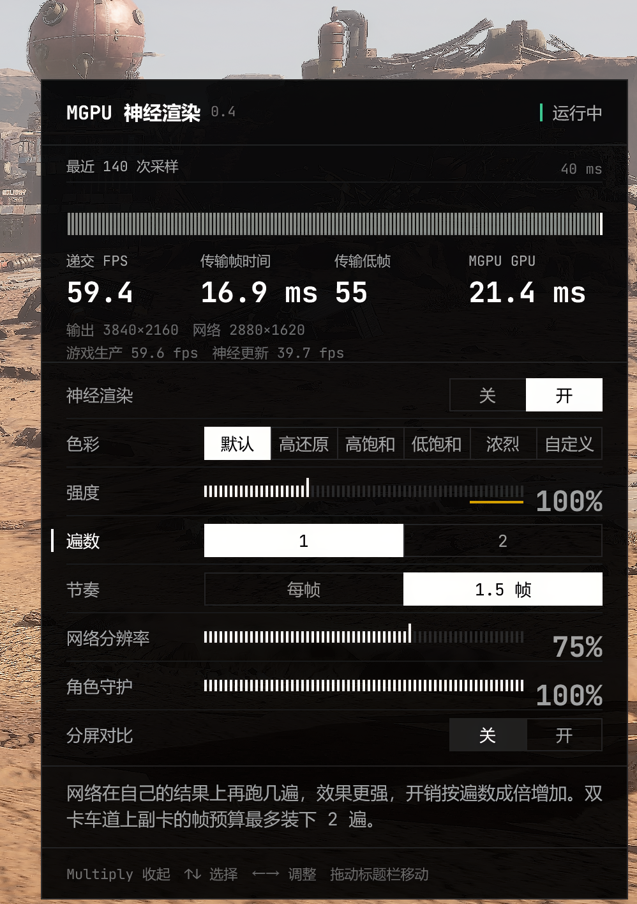

# MGPU Prism FG 1.0

**双卡神经渲染、固定 1.5 帧编辑场对齐，以及位于神经处理之后的 XeSS X2 帧生成。**

这是一个基于 MGPU／Neural Coprocessor 0.4 的社区二次开发版本。它保留主卡渲染、副卡神经处理的跨显卡链路，引入 Prism NR 的界面、调色及部分重建思路，并增加固定 1.5 帧节奏、Carry 编辑场对齐和输出端 XeSS FG。

> 这是供技术玩家测试的 1.0 版本，不是 NVIDIA、Intel、AMD、Prism NR 或游戏厂商的官方组件。兼容性、画质、延迟与性能提升因游戏和硬件而异，不能承诺普遍翻倍或所有场景零拖影。

## 1.0 做了什么

- **固定 1.5 帧节奏**：每三个游戏帧进行两次神经求值，间隔按两帧、一帧交替。不是根据复杂程度自动回退，也不是把插帧数字冒充神经求值。
- **PX1 降分辨率网络＋当前帧重建**：在低分辨率上运行神经求值，拟合神经编辑量，再把编辑量合成到当前原生颜色；不是简单放大一张低分辨率神经图。
- **Carry 编辑场对齐**：保持帧不再次调用 NGX，而是利用当前深度与运动向量对齐上一编辑场，并填充去遮挡区域，以减轻固定节奏下的拖影。
- **XeSS X2 输出级帧生成**：AMD Optical Flow 从同尺寸颜色估计运动，XeSS FG 使用这些运动信息和常量占位深度生成显示帧；不向 XeSS 提供真实游戏深度。
- **独立中文面板**：每帧／1.5 帧、网络分辨率、角色守护、FPS 对齐、分屏、时域累积、运动自适应、双卡中间帧、目标帧队列，以及六页 66 项自定义调色。
- **1.0 的发布边界**：面板只开放每帧／1.5 帧和 XeSS X2；每 2／4 帧、XeSS X3／X4 不属于本次开放功能。

完整处理顺序与公式见[架构与算法说明](ARCHITECTURE.md)。

## 实测截面

测试场景为《剑星》，RTX 3070 Ti 负责游戏渲染，RTX 5060 Ti 负责神经处理，输出为 3840×2160。

一次固定 1.5 帧运行截面中，游戏生产约 59.6 FPS，神经更新约 39.7 FPS，接近预期的三分之二。另一个开启 XeSS X2 的运行截面记录到游戏生产约 59.9 FPS、神经更新约 39.9 FPS、显示输出约 102.6 FPS。**这些是单次截面，不是平均性能，也不是相同场景下的严格 A/B 对照。**



测试条件、另一张截图和未完成的验收项见[实测与验收边界](RESULTS.md)。

## 运行环境

- 64 位 Windows；本版本的实机记录来自 Windows 11。
- 两张可用显卡；游戏渲染卡与神经处理卡必须按机器实际情况分配。
- 神经处理卡需要能够运行用户本机的 DLSS NR；XeSS FG 是否可用由实际硬件和 Intel 运行库共同决定。
- 游戏需能安装支持 add-on 的 ReShade。1.0 的实机重点是 D3D12 路径，不据此承诺所有 D3D11／D3D12 游戏兼容。
- 用户需自备合法获得的 NVIDIA DLSS NR 运行文件，项目不提供模型或 NVIDIA 二进制。

## 安装

先备份游戏目录中已有的注入和配置，再按[中文安装与排障指南](INSTALL.md)操作。核心目录如下，`<游戏目录>` 指游戏实际 exe 所在目录：

```text
<游戏目录>/
├─ nvngx.dll_mgpu_bridge.addon64
├─ mgpu.ini
├─ gpu1.ini
├─ ReShade2.ini
├─ libxess_fg.dll
├─ libxell.dll
├─ mgpu/
│  └─ nvngx_dlssnr.dll        用户自备，不随包提供
└─ reshade-shaders/
   └─ Shaders/
      └─ mgpu_depth_tap.fx
```

**插件文件名中的 `nvngx.dll` 是文件名的一部分，不要删掉。`nvngx_dlssnr.dll` 必须放进 `mgpu` 子目录，不要放在游戏 exe 旁。**

**如果从 `XeSSFG=0` 的全关状态启用 XeSS，必须在启动游戏前设置 `XeSSFG=1`，使代理在开局创建。进入游戏后才打开开关只会保存配置；需完整退出并重启游戏，不能指望当场补建代理。**

## 面板与快捷键

| 操作 | 按键 |
|---|---|
| 打开／关闭独立面板 | 小键盘 `*` |
| 选择与调整 | 方向键 |
| 翻页 | `Tab` |
| 进入自定义调色台 | `Enter` |
| 原生／神经分屏 | `Ctrl＋Alt＋F7` |
| 手动 Arm | `Ctrl＋Alt＋F10` |
| 仅在 Dcomp 模式隐藏／恢复神经画面 | `Ctrl＋Alt＋F6` |

`Home` 属于 ReShade，不是本项目的独立面板键。面板配置保存在游戏目录的 `mgpu_panel.ini`；例如将 `[Panel]` 下的 `OverlayKey=Multiply` 改为 `OverlayKey=F8` 可更换热键。

建议从 `PresentQueue=0`、`MiddleFrame=1` 开始。提高时域历史权重可以减轻部分闪烁，但也可能增加拖影；“目标帧队列”是额外排队帧，不是交换链缓冲区数量。

## 使用边界

- 运行中不要修改分辨率、游戏 DLSS 模式或会重建交换链的画质选项；请先退出游戏，再修改并重新启动。
- 不要同时启用游戏自身帧生成或第二条神经处理路径，避免重复代理和资源冲突。
- XeSS 增加的是显示输出帧，不提高游戏模拟率，也不等于神经求值率同步提高。
- `framesPresented=2` 是 X2 路径工作的运行证据，不代表任何场景都精确翻倍。
- 建议先用于离线单机。注入、窗口 hook 和第三方运行库可能触发反作弊；在线游戏的封禁与其他风险由使用者自行评估和承担。
- 目前缺少多机型、多游戏的统一画质、延迟与长时间稳定性验收，不应把本机结果直接外推。

## 源码与构建

核心实现位于：

```text
src/prism_x1.cpp       PX1 降采样、GuidedFit 与当前帧重建
src/prism_carry.cpp    求值帧编辑场保存、Carry 对齐与填充
src/amd_of.cpp         同尺寸时域稳定、AMD 光流与运动致密化
src/xess_fg.cpp        XeSS FG 代理、输入标记和输出统计
src/present_queue.cpp  DXGI 帧延迟队列控制
src/poverlay.cpp       独立面板与自定义调色台
```

构建工具、依赖布局和核验记录见[构建说明](BUILD.md)。源码包不包含 NVIDIA SDK 头文件，构建者需先阅读官方许可，再使用随附脚本从固定版本获取。当前源码中仍保留研发诊断和旧路径，不能仅凭文件存在就认定它们已经通过 1.0 实机验收。

## 致谢与授权

- MGPU／Neural Coprocessor：Marcelo Guibout，MIT。
- Prism NR：ChefZC／ChefDavid0815，MIT；本项目使用了其 1.5.1 的界面、调色和部分算法，并适配了 1.9.1 的编辑场对齐机制。
- ReShade：Crosire 与贡献者，BSD 三条款。
- Dear ImGui、MinHook、DLSSNR-Cost-Scaler：各自原许可。
- AMD FidelityFX SDK：只使用许可白名单中允许源码再分发的相关文件。
- Intel XeSS FG／XeLL：运行库保持原样，并附 Intel Simplified Software License。

本项目不代表上述作者或厂商为其背书。详细归属和许可文件位置见[第三方授权说明](THIRD_PARTY.md)；项目主体与新增代码沿用 [MIT 许可](LICENSE)。

## 发布文件

进入本仓库的 **Releases** 页面后：

- **运行包**：给已经装好 ReShade、并自备 NVIDIA 运行库的用户。
- **源码与文档包**：给需要审阅算法、构建插件或继续开发的用户。
- **SHA256SUMS.txt**：下载后用于核对文件完整性。
