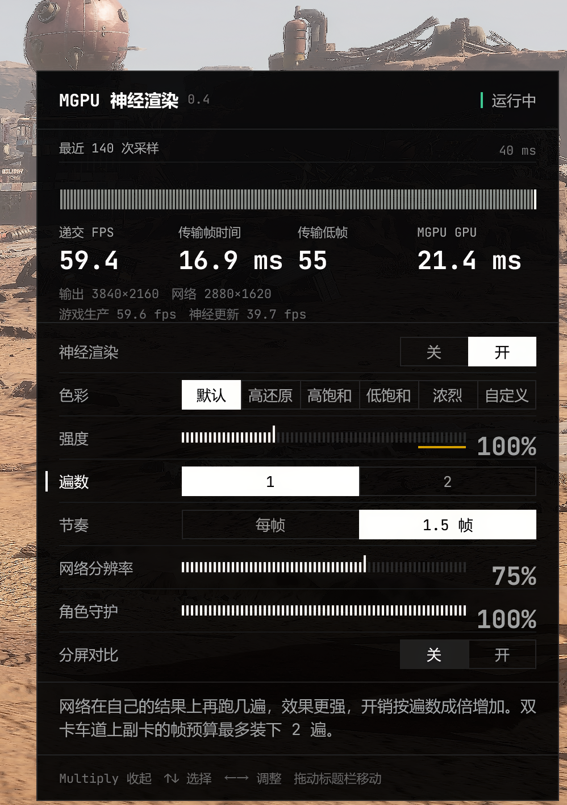
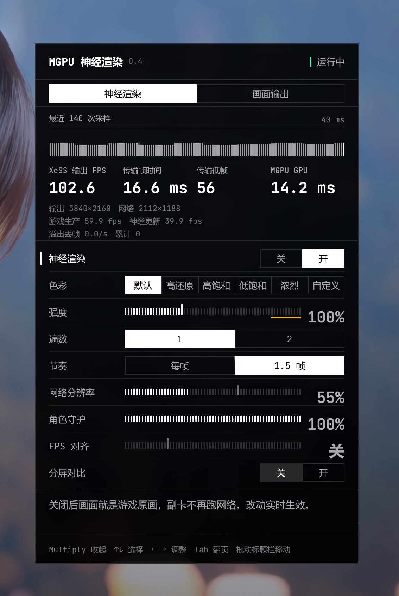

# 实测与验收边界

## 已记录的运行截面

| 项目 | 记录 |
|---|---|
| 游戏 | 《剑星》 |
| 游戏渲染卡 | NVIDIA RTX 3070 Ti |
| 神经处理卡 | NVIDIA RTX 5060 Ti |
| 截图所示输出 | 3840×2160 |
| 观察方式 | 游戏内面板截图，单次运行截面 |
| 不是 | 多轮均值、同机严格 A/B、跨游戏兼容性证明或输入延迟测量 |

### 固定 1.5 帧



该截面记录：

- 递交约 **59.4 FPS**；
- 游戏生产约 **59.6 FPS**；
- 神经更新约 **39.7 FPS**；
- 网络尺寸 **2880×1620**；
- 输出尺寸 **3840×2160**。

39.7／59.6 约为三分之二，与三帧两次求值的节奏相符。这是该次运行的节奏证据，不是“比原版快多少”的对照结论。

### XeSS X2



另一时刻的运行截面记录：

- 游戏生产约 **59.9 FPS**；
- 神经更新约 **39.9 FPS**；
- XeSS 输出约 **102.6 FPS**；
- 网络尺寸 **2112×1188**；
- 输出尺寸 **3840×2160**。

这里同时启用了 XeSS，网络尺寸也与上一张不同，因此两张图不能直接组成严格 A/B。102.6 FPS 属于显示输出，不能写成“神经求值达到 102.6 FPS”，也不能据此保证任何环境下精确翻倍。

## 构建一致性核验

发布运行包使用已部署的稳定插件：

```text
文件：nvngx.dll_mgpu_bridge.addon64
大小：2,381,824 字节
SHA-256：4698EEFDC0E1D6D2AC4755894FE8D29CCBDCFF5495E51729CF7720FC4E7FC5C0
```

发布副本也在独立构建目录完整编译成功。重建产物与稳定插件同为 2,381,824 字节，逐字节比较有 10 处不同：4 字节为 PE／调试目录时间戳，6 字节为内嵌编译时间字符串。运行包仍使用上方稳定插件；这不等于声明项目具有普遍可复现的字节级构建能力。

已排除一个撤回的窗口实验二进制，它没有打入运行包。1.0 不再借本次发布修改窗口穿透、焦点或 DirectComposition 行为。

## 尚未完成的验收

以下项目不能写成“已经通过”：

1. **XeSS 完整重启复验**：从全关状态设置 `XeSSFG=1` 后完整重启，确认代理创建、颜色／运动／占位深度提交与持续 `framesPresented=2`。
2. **同场景性能对照**：每帧、固定 1.5 帧、固定 1.5＋XeSS X2，以及 MGPU 0.4 基线，分别采样足够时长并记录帧间隔。
3. **真实延迟**：需要高速摄影或等效端到端测量，不能从面板 FPS 推导。
4. **画质对照**：同机位静态与动态录屏，检查皮肤、文字、粒子、透明物体、快速转身、去遮挡和光流插值瑕疵。
5. **长时间稳定性**：至少覆盖场景切换、菜单、暂停、Alt＋Tab、退出与多次重启。
6. **多游戏与多硬件**：本记录不能外推到其他显卡组合、分辨率、驱动或游戏。

## 建议的社区反馈格式

反馈问题时请附：

- 游戏与版本、exe 名称、D3D11／D3D12；
- 两张显卡型号、驱动版本、显示器连接方式；
- 游戏分辨率、网络分辨率、每帧／1.5 帧、XeSS 开关；
- 游戏生产、神经更新、显示输出三组数值；
- 问题发生前是否修改过分辨率或 DLSS；
- 脱敏后的 `ReShade.log` 关键片段与复现步骤。

不要只报告一个总 FPS；它不足以定位神经节奏、光流、XeSS 或 Present 中的具体问题。
